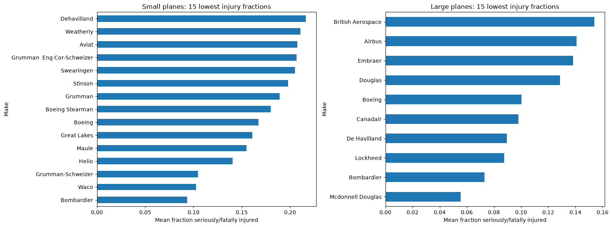
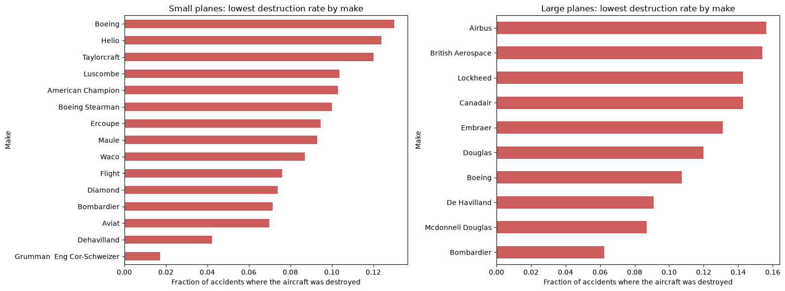
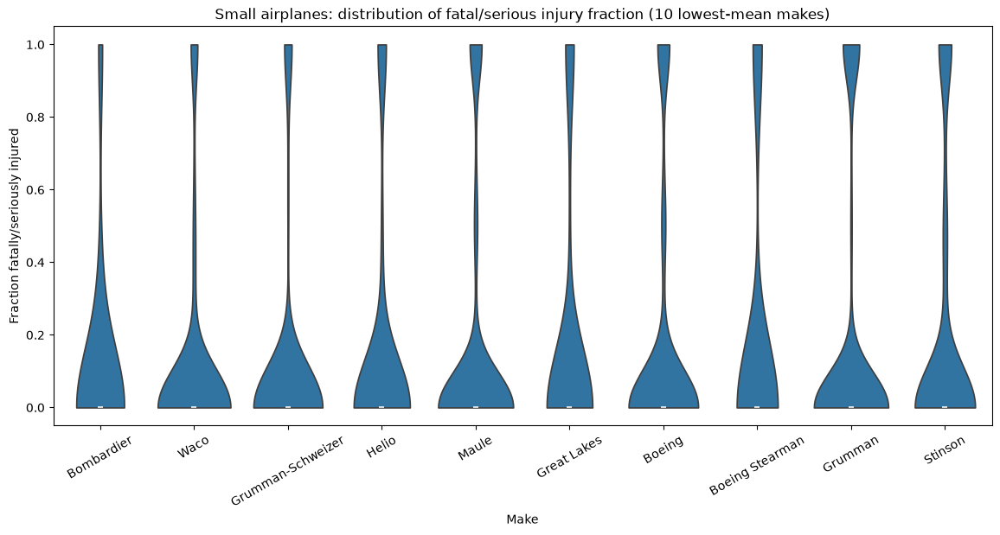
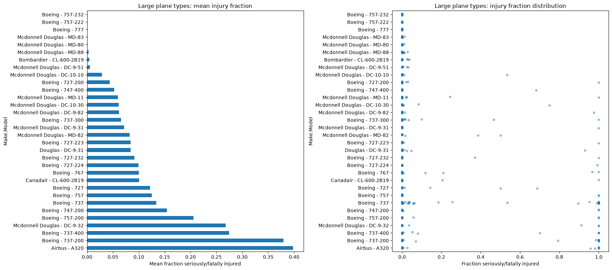
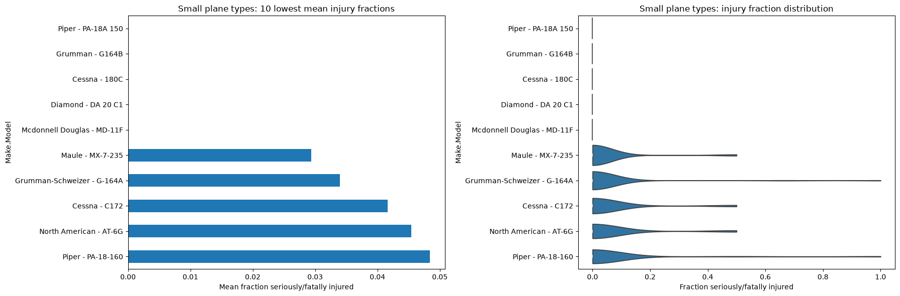
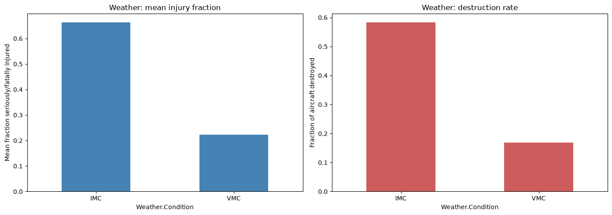
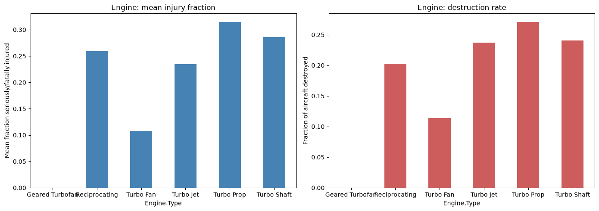

# Aviation Accident Analysis

## Overview

For this project, I worked as a consultant for an airline/airplane insurer. The client wants to know **which airplanes (makes and models) have a low risk of being destroyed and a low risk of serious or fatal injuries in the event of an accident**. They also want to know which conditions play a role in how bad an accident is.

The client asked for:
- only **professional builds** (no amateur-built planes)
- only planes that could still be active, so accidents from **1983 onwards** (max lifetime of 40 years)
- **separate recommendations for small and large airplanes**

## Data

The data comes from the NTSB aviation accident dataset (`data/AviationData.csv`). It has **88,889 events and 31 columns**, from 1948 to 2022.

After cleaning, I kept **59,812 airplane accidents**, saved in `data/AviationDataCleaned.csv`.

## Data Cleaning

All the steps are in `Aviation_Accidents_Cleaning.ipynb`. In short:

- **Filtering**
  - I kept events from 1983 onwards and only professional builds.
  - About 64% of `Aircraft.Category` was missing. A manufacturer almost always builds one type of aircraft (Cessna -> Airplane, Robinson -> Helicopter), so I filled the missing values with the most common category for each Make. Then I kept only **airplanes**.
- **Injury metric**
  - Missing injury counts were recorded as 0.
  - I estimated the number of people on board: `Total.Passengers` = fatal + serious + minor + uninjured. Events with 0 people were removed.
  - `Fraction.Serious.Fatal` = (fatal + serious) / `Total.Passengers`. This is the likelihood of serious/fatal injury in an accident.
- **Damage:** I dropped the "Unknown" damage values and created `Aircraft.destroyed` (1 if the aircraft was destroyed, else 0).
- **Make**
  - I made the letter case the same ("CESSNA" -> "Cessna").
  - I removed suffixes like *Aircraft, Corp, Inc, Co, Design, Ltd*.
  - I kept only makes with at least **50** events.
- **Model:** I removed the NaN values. The same model name can belong to different makes, so I created a `Make.Model` column as a unique identifier for each plane type.
- **Other columns:** I merged the spelling variants in `Weather.Condition`, `Engine.Type`, `Purpose.of.flight` and `Broad.phase.of.flight` ("UNK", "Unk" -> "Unknown"). I also treated 0 engines as missing.
- **Columns removal:** I dropped the columns with too many NaNs (fewer than 20,000 values).

## Method

All the analysis is in `Aviation_Accidents_Data_Analysis.ipynb`.

- **Small vs Large:** plane size belongs to the plane type, not to a single flight (a 737 on a ferry flight may carry only 2 crew). So I classified each `Make.Model` by the **median number of people on board** across its accidents: more than 20 -> **Large**, otherwise **Small**. This gives 58,386 small-plane accidents and 1,426 large-plane accidents.
- **Enough samples:** to compare groups fairly, I kept only makes with **at least 10 accidents** in each size group, and plane types with **at least 10 accidents**.
- For each group, I calculated the **mean fraction of people seriously/fatally injured** and the **destruction rate** (fraction of accidents where the aircraft was destroyed).

## Results

### 1. Small vs Large

A large plane accident is much more survivable than a small plane accident:

| Plane size | Mean injury fraction | Destruction rate |
|---|---|---|
| Small | **27.5%** | **21.4%** |
| Large | **9.9%** | **11.0%** |

### 2. Makes





- **Distribution:** the injury fraction is not spread evenly. Most accidents are either 0 (nobody seriously hurt) or 1 (everyone seriously hurt or killed). For the best makes, **72–89% of accidents had no serious injuries**. So a make's mean injury fraction mainly shows **how often its accidents are catastrophic**.



- **Small makes:**
  - The lowest injury fractions belong to Waco, Grumman-Schweizer, Helio, Maule and Great Lakes.
  - The lowest destruction rates belong to Aviat, Diamond, Maule and Waco.
  - Many of them (Waco, Great Lakes, Stinson, Boeing Stearman, Helio) are vintage planes that are not built anymore.
- **Large makes:** all the major airliner manufacturers have **low and similar** injury fractions (between about 0.06 and 0.14). Bombardier has the lowest destruction rate (**6.2%**). Boeing has by far the largest sample (**810 accidents**), so its results are the most reliable.

### 3. Plane types



- **Large:** the **Boeing 777** and the **Boeing 757-232 / 757-222** had **no serious or fatal injuries in any of their accidents**. The **McDonnell Douglas MD-80 / MD-83 / MD-88** and the **Bombardier CRJ-200** were almost as good. Older types like the Boeing 737-200, 737-400 and DC-9-32 are the worst.



- **Small:** the best types are the Piper PA-18A-150, Grumman G-164B, Cessna 180C, **Diamond DA20-C1**, **Maule MX-7-235** and **Piper PA-18-160**. In 92–100% of their accidents, nobody was seriously or fatally injured.

### 4. Factor 1: Weather condition



- In bad visibility (**IMC**), **66%** of the people on board were seriously or fatally injured on average, against **22%** in good visibility (**VMC**). That is about **3 times higher**.
- **58%** of aircraft were destroyed in IMC accidents, against **17%** in VMC.
- When visibility is poor, pilots can lose their orientation or fly into terrain they can't see, so these accidents are rarely survivable.

### 5. Factor 2: Engine type



- **Turbofan** aircraft have the lowest values: **10.8%** injury fraction and **11.4%** destroyed (1,318 accidents).
- **Turboprop** aircraft are the worst: **31.5%** and **27.1%** (2,608 accidents).
- **Reciprocating** (piston) engines, which power most small planes, are in the middle: **25.9%** and **20.3%** (51,863 accidents).
- Turbofans power most airliners and business jets, which have stricter standards and professional crews. So part of this advantage comes from the type of aircraft and operation, not only from the engine.

## Recommendations

1. **Small airplanes:** **Maule, Aviat and Diamond**. They are still in production and have both a low injury fraction and a low destruction rate. For specific models: **Maule MX-7-235**, **Piper PA-18-160** and **Diamond DA20-C1**.
2. **Large airplanes:** **Boeing and Bombardier**. For specific models: **Boeing 777** (the strongest choice, modern and still in service), **Boeing 757-200 series**, **MD-88** and **Bombardier CRJ-200**.
3. **Weather:** give a higher risk to operators that fly often in IMC. Planes well equipped for instrument flight and instrument-rated pilots should be a key factor.
4. **Engine type:** turbofan-powered aircraft carry the lowest risk. Turboprops carry the highest.

## Limitations

- The dataset contains **only accidents**. The rates show how survivable an accident is, not how often a plane has accidents.
- Many plane types have only 10–25 accidents, so a single fatal crash can change the ranking a lot.
- Some manufacturers still appear under different names (for example "Dehavilland" / "De Havilland", "Canadair" / "Bombardier").

## Repository structure

```
Module_08/
├── Aviation_Accidents_Cleaning.ipynb       # loading, inspection and cleaning
├── Aviation_Accidents_Data_Analysis.ipynb  # EDA, plots and recommendations
├── data/
│   ├── AviationData.csv                    # raw data
│   └── AviationDataCleaned.csv             # cleaned data
├── images/                                 # plots used in this README
└── README.md
```

## How to run

1. Install `pandas`, `numpy`, `matplotlib` and `seaborn`.
2. Run `Aviation_Accidents_Cleaning.ipynb` first (it creates `data/AviationDataCleaned.csv`).
3. Then run `Aviation_Accidents_Data_Analysis.ipynb`.
